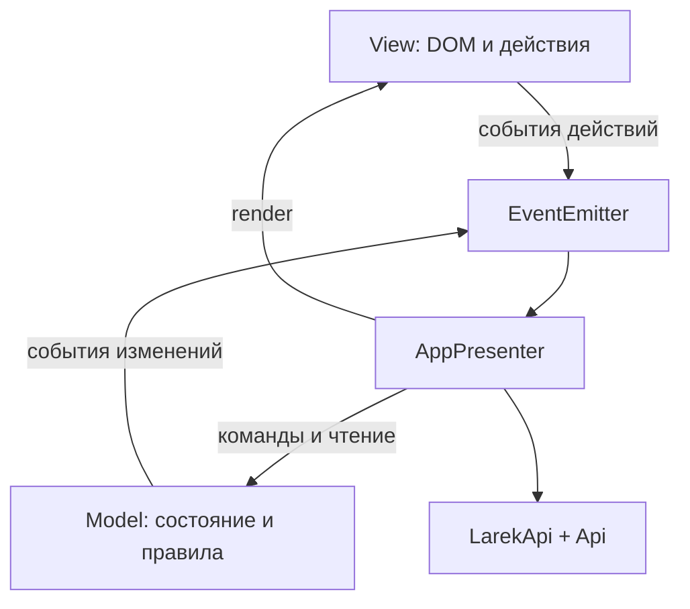

# WEB-ларёк — разработка архитектуры

Проект № 4, спринт 9 Яндекс Практикума. Интернет-магазин товаров для веб-разработчиков: каталог, просмотр товара, корзина и оформление заказа в два шага.

**Результат текущего спринта — архитектура и объявления типов, а не работающий магазин.** В `src/index.ts` пока только импорт стилей. На странице остаётся демонстрационное модальное окно из стартового набора; его кнопки пока не работают. Это ожидаемое состояние этого этапа.

Стек: HTML, SCSS, TypeScript, Webpack. Используются исходные `Api`, `EventEmitter`, DOM-утилиты и HTML-шаблоны. Фреймворки и новые зависимости не добавлены.

## 1. Установка и запуск

Распакуйте архив. Все команды выполняются **в папке `web-larek-frontend-main`, где находится `package.json`**, а не уровнем выше. Ниже пример для архива, распакованного в Downloads:

```powershell
cd "$HOME\Downloads\WEB_LAREK_PROJECT4_READY\web-larek-frontend-main"
Get-Item .\package.json
Copy-Item .env.example .env
npm ci
npm start
```

Если распаковали архив в другое место, замените путь в первой команде. `Copy-Item` нужен один раз при первоначальной настройке. При уже существующем `.env` сначала проверьте его содержимое, чтобы не затереть свои настройки.

Dev-сервер выводит адрес в терминал, обычно `http://localhost:8080`. Для остановки — `Ctrl+C`. Проверено в Linux на Node.js 24.19.0 / npm 11.9.0; отдельный запуск на Windows не проводился.

Содержимое `.env` согласно ТЗ:

```dotenv
API_ORIGIN=https://larek-api.nomoreparties.co
```

Адрес указывается без завершающего `/`. `src/utils/constants.ts` формирует:

- `API_URL = API_ORIGIN + '/api/weblarek'`;
- `CDN_URL = API_ORIGIN + '/content/weblarek'`.

Webpack читает сначала `.env.<NODE_ENV>`, затем `.env` как общую конфигурацию. Уже заданные переменные процесса имеют приоритет над обоими файлами. Это позволяет одной настройке `.env` работать и в dev-, и в production-сборке. Переменная API публичная: её значение попадёт в клиентский код. Секреты сюда не помещаются. В архиве есть только `.env.example`.

Проверки и production-сборка:

```powershell
npx tsc --noEmit
npm run lint
npm run build
```

Результат сборки — `dist/`. `npm run build:dev` создаёт development-сборку, `npm run watch` следит за изменениями. Скрипт `deploy` унаследован от стартового набора; публикация в рамках задания не выполнялась. Не применяйте `npm audit fix --force` без отдельного разбора зависимостей.

## 2. Что находится в проекте

| Путь | Назначение и состояние |
| --- | --- |
| `src/index.ts` | Существующая точка входа; пока только SCSS. В следующем спринте — создание объектов и запуск presenter |
| `src/types/index.ts` | Реализованные объявления DTO, моделей, представлений, API и событий |
| `src/components/base/api.ts` | Существующий HTTP-клиент |
| `src/components/base/events.ts` | Существующий брокер событий, минимально уточнена типизация |
| `src/utils/utils.ts` | DOM-утилиты, минимальные исправления типизации и проверка пустого шаблона |
| `src/utils/constants.ts` | Существующие адреса API и CDN |
| `src/pages/index.html` | Исходная демонстрационная разметка и семь рабочих шаблонов |
| `src/scss/`, `src/common.blocks/` | Исходные стили и блоки; сохранены |
| `src/images/`, `src/public/`, `src/vendor/` | Исходные ресурсы и шрифты |
| `.env.example` | Пример адреса API из ТЗ |
| `webpack.config.js` | Исходная сборка с исправленным чтением `.env` |
| `tsconfig.json` | Конфигурация TypeScript; включён `strictNullChecks` |
| `package.json`, `package-lock.json` | Скрипты и зависимости; восстановлена отсутствовавшая lock-запись `fsevents` |
| `api.yml` | Унаследованная спецификация **другого проекта Film!/Afisha**; не используется для WEB-ларька |
| `PROJECT_REPORT.md` | Результаты проверки, соответствие ТЗ и передача HEAD |

Запланированные, **пока не созданные** файлы: `src/components/models/{CatalogModel,BasketModel,OrderModel}.ts`, `src/components/views/` с классами ниже, `src/components/LarekApi.ts`, `src/components/AppPresenter.ts`. Небольшие чистые функции подготовки отображения разместятся в `src/utils/viewData.ts`. Пустые классы и файлы-заглушки не добавляются.

## 3. MVP и распределение ответственности

Выбран **Model–View–Presenter с EventEmitter**. Model хранит состояние и бизнес-правила, View работает с DOM, Presenter координирует их и API. Брокер передаёт намерения пользователя и уведомления об изменениях моделей. Обратное обновление представления происходит через явный вызов `render`, а не через самостоятельное чтение модельного состояния представлением.



- **SRP:** каталог отвечает за товары, корзина — за выбор товаров, заказ — за поля покупателя. `Modal` отвечает только за контейнер окна.
- **SSOT:** каталог хранит товары, корзина хранит только их ID, `OrderModel` хранит только черновик. Сумма и счётчик вычисляются из корзины; копий этих значений в моделях заказа нет. DOM не служит источником бизнес-данных.
- **DRY:** общий `Form<T>` содержит повторяющуюся работу с submit, ошибками и disabled; один `Modal` обслуживает все окна.
- **KISS:** три самостоятельных класса карточек без универсального базового класса с десятками необязательных полей; небольшие функции форматирования общие.
- **Dependency Inversion:** модели получают `IEvents`, корзина — `ICatalogModel`, presenter — интерфейсы моделей и `ILarekApi`. `LarekApi` получает HTTP-клиент через конструктор. Глобальных зависимостей внутри моделей нет.
- **Композиция:** `LarekApi` содержит `Api`, `Basket` получает готовые DOM-строки карточек, `Modal` — готовое содержимое. Единственное запланированное наследование — две формы от `Form<T>`.

Ни одна модель не читает DOM. Ни одно представление не делает HTTP-запросы и не меняет корзину напрямую. Каталог загружается один раз при запуске; автоматическое обновление цен во время оформления не планируется. Повтор после ошибки загрузки возможен до появления корзины. Если позднее понадобится фоновое обновление каталога, согласование удалённых товаров и изменившихся цен — отдельное расширение.

## 4. Типы и преобразования данных

Все объявления находятся в `src/types/index.ts`. Они являются действительным TypeScript-кодом, но интерфейсы не создают объекты и не реализуют поведение.

| Тип | Смысл |
| --- | --- |
| `IProductDTO` | Ответ товара: `id`, `title`, `description`, `image`, `category` — строки, `price: number \| null` |
| `IProductListResponse` | Алиас существующего `ApiListResponse<IProductDTO>`: `total` и `items` |
| `IProduct` | Внутренний товар: вместо серверного `image` содержит нормализованный `imageUrl` |
| `IPurchasableProduct` | Товар с подтверждённой числовой ценой; используется в снимке корзины |
| `PaymentMethod` | `'card' \| 'cash'`; «Онлайн» → `card`, «При получении» → `cash` |
| `IOrderDraft` | `payment: PaymentMethod \| null`, `address`, `email`, `phone` |
| `IOrderFormData`, `IContactsFormData` | Соответственно первая и вторая группы полей черновика |
| `IOrderRequest` | Ненулевой `payment`, поля покупателя, числовой `total`, массив ID `items` |
| `IOrderResponse` | Проектный результат `{ id: string; total: number }`, см. статус API ниже |
| `IApiErrorResponse` | Ожидаемое серверное сообщение `{ error: string }` |
| `IBasketSnapshot` | Временный снимок выбранных товаров с числовой ценой, суммой и количеством |
| `IValidationResult<T>` | `valid` и ошибки полей `Partial<Record<keyof T, string>>` |
| `IProductView` | Подготовленные заголовок, категория, URL, CSS-модификатор и текст цены |
| `IProductPreviewView` | Подробности, `inBasket`, действие `add/remove/unavailable`, текст и disabled кнопки |
| `IBasketItemView` | ID, порядковый номер с 1, название и текст цены |
| `IBasketView` | DOM-строки, строка суммы, признак запрета оформления |
| `IPageView` | DOM-карточки, число товаров корзины, блокировка прокрутки |
| `IFormState<T>` | Значения полей, валидация, `pending`, отдельная серверная ошибка |
| `ISuccessView`, `IModalView` | Строка списанной суммы / DOM-содержимое окна |
| `ICatalogModel`, `IBasketModel`, `IOrderModel`, `ILarekApi`, `IView<T>` | Контракты будущих объектов |
| `AppEventMap` | Имена событий и их полезная нагрузка |

### Путь данных

1. `LarekApi.getProducts()` получает и проверяет JSON, возвращает DTO, не DOM.
2. `CatalogModel.setItems()` преобразует DTO в `IProduct`. При относительном пути удаляет лишние слеши на стыке и соединяет `CDN_URL + '/' + image`; абсолютный HTTP(S) URL сохраняет. Так путь `/item.svg` не превращается ошибочно в адрес от корня API без `/content/weblarek`.
3. Presenter через чистые функции готовит данные View: `price === null` → «Бесценно», число → «N синапсов». `0` — допустимая числовая цена, а не отсутствие цены. Для расчётов остаётся число; текст цены назад не разбирается.
4. Категории отображаются как `софт-скил → soft`, `хард-скил → hard`, `другое → other`, `дополнительное → additional`, `кнопка → button`. Неизвестная категория сохраняет текст и использует `other`.
5. Состояние подробной кнопки выводится из товара, `basket.has(id)` и `pending`. При `null` приоритет всегда у `unavailable`; иначе в корзине → `remove`, отсутствует → `add`.
6. Перед отправкой `OrderModel.toRequest(basket.getSnapshot())` проверяет обе формы и корзину и создаёт отдельный HTTP-снимок. `imageUrl`, тексты интерфейса, индексы и прочие View-поля в запрос не попадают.

Геттеры моделей возвращают копии/readonly-снимки, не изменяемые внутренние коллекции. `readonly` защищает на уровне TypeScript; в реализации нужны копии массивов и объектов. Снимки не хранятся параллельно как второе постоянное состояние. Проверка JSON на границе обязательна: объявление интерфейса и `as IProductDTO` сами по себе не проверяют серверные данные.

### Статус серверного контракта

ТЗ подтверждает origin и содержит ссылку на [официальную Postman-коллекцию](https://larek-api.nomoreparties.co/weblarek.postman.json). Исходный `constants.ts` подтверждает префиксы API/CDN. 20.10.2026 попытки чтения коллекции и `GET https://larek-api.nomoreparties.co/api/weblarek/product/` из среды проверки получили HTTP 503. Это не доказывает недоступность сервиса у всех пользователей.

Поэтому `GET /product/`, `POST /order/`, поля товарных DTO, значения оплаты и результат `{id, total}` приняты как **проектные контракты из задания HEAD, не как подтверждённые текущим ответом сервера**. Перед реализацией следующего спринта их нужно сверить с доступной официальной коллекцией. `POST /order/` не выполнялся; успешная покупка не имитировалась. `api.yml` про фильмы не является подтверждением ни одного из этих контрактов. Неиспользуемый endpoint получения отдельного товара не добавляется: подробности есть в каталоге.

## 5. Существующие базовые классы

### Api — реализован

Файл `src/components/base/api.ts`. Конструктор `new Api(baseUrl: string, options: RequestInit = {})`. Поля: публичный readonly `baseUrl`, protected `options`. В текущем коде из `options` используются заголовки; не следует предполагать поддержку других настроек RequestInit без отдельной доработки.

- `get(uri: string): Promise<object>` — GET по `baseUrl + uri`.
- `post(uri: string, data: object, method: ApiPostMethods = 'POST'): Promise<object>` — JSON-запрос. `ApiPostMethods` = `POST | PUT | DELETE`.
- protected `handleResponse(response: Response): Promise<object>` — разбирает JSON; отклоняет Promise при неуспехе. HTML-ошибка или невалидный JSON также отклонят Promise.
- `ApiListResponse<T>` — `{ total: number; items: T[] }`.

HTTP-клиент не знает о товарах, корзине, DOM и событиях. Его реализация сохранена без изменений.

### EventEmitter — реализован

Файл `src/components/base/events.ts`. Конструктор без аргументов; `_events: Map<string | RegExp, Set<Subscriber>>` хранит подписчиков. Поле не используется приложением напрямую. `Subscriber` уточнён до `(data: unknown) => void` вместо `Function`; non-null assertion в `off` заменён optional chaining.

- `on<T extends object>(event, callback): void` — подписаться на строку либо RegExp.
- `off(event, callback): void` — снять конкретную подписку той же ссылкой на callback.
- `emit<T extends object>(event: string, data?: T): void` — синхронно вызвать подписчиков.
- `onAll(callback): void` — подписка на `*`, получает `{ eventName, data }`.
- `offAll(): void` — удалить все подписки; используется только при полном завершении приложения.
- `trigger<T extends object>(event, context?): (data: T) => void` — создать callback для генерации события с контекстом.

Интерфейс `IEvents` содержит `on`, `emit`, `trigger`; `off` доступен у самого `EventEmitter`. Конкретный брокер передаётся presenter для управления жизненным циклом подписок; модели и View пользуются `IEvents`. Карта `AppEventMap` документирует и типизирует payload, но **не делает штатный брокер автоматически строго типизированным по имени события**. В следующем спринте используются явные параметры типа:

```typescript
// Пример будущего использования, сейчас в точке входа его нет.
events.on<AppEventMap['product:select']>('product:select', ({ id }) => {
  // Presenter получает товар по id и открывает подробности.
});
events.emit<AppEventMap['product:select']>('product:select', { id: product.id });
```

Для событий без данных передаётся `{}`. На изменения моделей подписывается presenter, а не каждая карточка. Подписки создаются один раз, не при каждом открытии окна.

## 6. Запланированные модели и API-адаптер

**Все классы этого раздела только спроектированы; их исполняемых реализаций в архиве нет.** Названия методов соответствуют интерфейсам в `src/types/index.ts`.

### CatalogModel implements ICatalogModel

Конструктор: `constructor(events: IEvents, cdnUrl: string)`.

Поля: private `_items: IProduct[]`, `events`, `cdnUrl`. Геттер `items` возвращает readonly-копию каталога.

- `setItems(items: readonly IProductDTO[]): void` — нормализует изображения и атомарно заменяет каталог; отклоняет повторяющиеся ID и некорректные данные, не сохраняя частичный результат; вызывает `catalog:changed`.
- `getProduct(id: string): Readonly<IProduct> | undefined` — найти товар или вернуть `undefined`.

Выбранный товар для открытого окна — временное состояние presenter, а не второй каталог. Модель не знает о корзине и CSS.

### BasketModel implements IBasketModel

Конструктор: `constructor(catalog: ICatalogModel, events: IEvents)`.

Поля: private `_ids: Set<string>`, `catalog`, `events`. `ids: readonly string[]` — копия выбранных ID в порядке добавления. Названия и цены берутся из каталога, а не дублируются в корзине.

- `has(id): boolean` — проверить наличие.
- `add(id): BasketAddResult` — найти товар и проверить цену; результаты `added`, `duplicate`, `unavailable`, `not-found`. При `null` и неизвестном ID не добавляет. Повтор не изменяет состояние.
- `remove(id): void` — удалить, если товар есть.
- `clear(): void` — очистить.
- `getSnapshot(): IBasketSnapshot` — получить копии товаров с числовой ценой, вычисленные `total` и `count`. Невалидный ID/цена после нарушения инварианта каталога — ошибка состояния, не молчаливое исключение товара из суммы.

`basket:changed` вызывается только после фактического изменения. Пустая корзина имеет `count = 0`, `total = 0`. Запрет оформления определяется количеством, **не условием `total > 0`**, поскольку товар с ценой 0 допустим.

### OrderModel implements IOrderModel

Конструктор: `constructor(events: IEvents)`.

Поля: private `_draft: IOrderDraft`, `events`. Начальный черновик: `{payment: null, address: '', email: '', phone: ''}`. Геттер `draft` возвращает копию.

- `update(data: Partial<IOrderDraft>): void` — изменить разрешённые поля и вызвать `order:changed` при изменении. Во время ввода сохраняется текст пользователя, без агрессивного trim на каждом символе.
- `reset(): void` — вернуть начальные значения, уведомить об изменении.
- `validateOrder(): IValidationResult<IOrderFormData>` — проверить выбор оплаты и `address.trim().length > 0`.
- `validateContacts(): IValidationResult<IContactsFormData>` — проверить непустые `email.trim()` и `phone.trim()`.
- `toRequest(basket: IBasketSnapshot): IOrderRequest` — повторно проверить обе формы, непустую корзину, уникальные ID, числовые неотрицательные цены и согласованную сумму. При ошибке бросить `Error`, не создавать некорректный запрос. При успехе вернуть новый объект с trim строк, ненулевым payment, ID и суммой из снимка.

В модели нет `items`, `total` и `pending` как собственного постоянного состояния. Она не отправляет HTTP-запросы.

### LarekApi implements ILarekApi

Конструктор: `constructor(http: Pick<Api, 'get' | 'post'>)`. Поле private `http`. На этапе сборки приложения передаётся `new Api(API_URL)`.

- `getProducts(): Promise<IProductListResponse>` — `http.get('/product/')`, проверка оболочки и полей DTO; числовые цены должны быть конечными и неотрицательными либо `null`.
- `createOrder(order: IOrderRequest): Promise<IOrderResponse>` — `http.post('/order/', order)`, проверка `id` и конечного неотрицательного `total`.

Возвращает отклонённый Promise при HTTP-, сетевой или контрактной ошибке. Ошибка приводится к безопасному тексту в presenter: `Error.message`, непустая строка либо общее сообщение. Не вставляет HTML ответа в страницу. Не хранит корзину и не решает, когда её очищать.

## 7. Запланированные представления

Все представления получают DOM-контейнер и зависимости через конструктор. Они запоминают ссылки на нужные элементы, а не ищут их по всему документу при каждом `render`. Общий контракт — `IView<T>.render(data: T): HTMLElement`; метод обновляет контейнер и возвращает его. `destroy(): void` снимает собственные DOM-обработчики перед окончательным удалением экземпляра. Обычное закрытие модального окна не уничтожает переиспользуемые формы.

| Класс | Конструктор | Поля / публичные методы сверх `render` и `destroy` |
| --- | --- | --- |
| `Page` | `(container: HTMLElement, events: IEvents)`; container — `.page__wrapper` | Ссылки на `.gallery`, `.header__basket`, `.header__basket-counter`; `render(IPageView)` обновляет карточки, счётчик и `.page__wrapper_locked` |
| `CardCatalog` | `(container: HTMLButtonElement, events: IEvents)` | ID и ссылки на title/image/category/price; `render(IProductView)` |
| `CardPreview` | `(container: HTMLElement, events: IEvents)` | ID, последнее UI-действие, description, `.card__button` и остальные поля; `render(IProductPreviewView)` |
| `CardBasket` | `(container: HTMLLIElement, events: IEvents)` | ID, index/title/price/delete; `render(IBasketItemView)` |
| `Basket` | `(container: HTMLElement, events: IEvents)` | `.basket__list`, `.basket__price`, `.basket__button`; `render(IBasketView)` вставляет готовые строки и задаёт disabled |
| `Modal` | `(container: HTMLElement, events: IEvents)`; container — `#modal-container` | `.modal__content`, `.modal__close`, состояние открыт/закрыт; `render(IModalView)`, `open(): void`, `close(): void` |
| `Form<T>` (абстрактный) | `(container: HTMLFormElement, events: IEvents, submitEvent: 'order:submit' \| 'contacts:submit')` | submit-кнопка, `.form__errors`; `render(IFormState<T>)`, protected абстрактный `renderValues(values: T): void` |
| `OrderForm extends Form<IOrderFormData>` | `(container: HTMLFormElement, events: IEvents)` | payment-кнопки и address; передаёт `order:submit` базовому конструктору, отображает `IOrderFormView` |
| `ContactsForm extends Form<IContactsFormData>` | `(container: HTMLFormElement, events: IEvents)` | email/phone; передаёт `contacts:submit`, отображает `IContactsFormView` |
| `Success` | `(container: HTMLElement, events: IEvents)` | `.order-success__description`, `.order-success__close`; `render(ISuccessView)` |

`render` не генерирует событий изменения бизнес-данных. Все пользовательские тексты задаются через `textContent`/`value`, не через конкатенацию HTML.

- `CardCatalog` сообщает только ID выбранного товара. `CardPreview` сообщает намерение добавить/удалить по уже переданному UI-действию; presenter и модель повторно проверяют допустимость.
- `CardBasket` удаляет товар по ID, не по порядковому номеру. Номер — только визуальная позиция.
- `Form` предотвращает нативную отправку формы; отключает submit при `!validation.valid || pending`. При `pending` также отключаются поля и payment-кнопки. Серверная ошибка и ошибки полей выводятся текстом в существующем `.form__errors`.
- Подклассы форм только читают ввод и публикуют field/value; `OrderModel` определяет валидность. Для контактов не вводятся регулярные выражения, маски и нативные format-ограничения, отсутствующие в ТЗ.
- `Modal` закрывается по крестику и клику на фон (`event.target === container`). Клик по содержимому окно не закрывает. `open/close` идемпотентны и генерируют события только при переходе состояния. Presenter по ним блокирует/разблокирует страницу.
- `Success` только показывает результат и вызывает `success:close`; корзину и черновик этот класс никогда не очищает.

### Соответствие исходной разметке

| HTML-шаблон / контейнер | Представление |
| --- | --- |
| `#card-catalog` | `CardCatalog` |
| `#card-preview` | `CardPreview` |
| `#card-basket` | `CardBasket` |
| `#basket` | `Basket` |
| `#order` | `OrderForm` |
| `#contacts` | `ContactsForm` |
| `#success` | `Success` |
| `#modal-container` | Один `Modal` для всех сценариев |
| `.page__wrapper` | `Page` |

Сейчас все семь шаблонов и демонстрационные окна сохранены без изменения. В следующем спринте при подключении приложения следует убрать из DOM именно демонстрационные окна (в том числе стартовый `.modal_active`), сохранив `#modal-container` и все `<template>`. Для загрузки/ошибки каталога presenter сможет создавать текстовый элемент в `.gallery` без отдельного нового класса.

## 8. AppPresenter — запланированный управляющий слой

Конструктор: `constructor(dependencies: { events: EventEmitter; api: ILarekApi; catalog: ICatalogModel; basket: IBasketModel; order: IOrderModel; page: Page; modal: Modal; basketView: Basket; orderForm: OrderForm; contactsForm: ContactsForm; success: Success; templates: { catalog: HTMLTemplateElement; preview: HTMLTemplateElement; basketItem: HTMLTemplateElement } })`.

View-классы в этом описании ещё не объявлены в TypeScript: это архитектурная сигнатура следующего спринта. В реализации зависимости представлений можно типизировать через их публичные интерфейсы.

Поля: зависимости; `selectedProductId: string | null`; `activeScreen: 'preview' | 'basket' | 'order' | 'contacts' | 'success' | null`; `pending: boolean`; `serverError: string | null`; признак `started`; зарегистрированные callback для снятия подписок; созданные экземпляры карточек. `pending` и активный экран — временное состояние процесса/UI, не копия заказа или корзины.

Публичные методы:

- `start(): Promise<void>` — один раз подписаться на события и загрузить каталог. Перехватить ошибку загрузки и показать текст в галерее. Повторный вызов не создаёт повторных подписок.
- `destroy(): void` — снять свои подписки через `off`, уничтожить представления и пометить экземпляр завершённым; незавершённые запросы после завершения не обновляют DOM.

Внутренние обязанности разделяются на небольшие методы: загрузка каталога, открытие товара/корзины/шага формы, пересборка View-данных, обработка полей, отправка заказа. Правила покупки и валидации не копируются из моделей в presenter. События моделей запускают перечитывание актуальных геттеров; presenter не поддерживает второй набор данных.

`src/index.ts` в следующем спринте станет точкой композиции: создаёт один брокер, API-адаптер, модели, представления, presenter и вызывает `start()`.

## 9. События и связи

| Событие | Кто отправляет | Payload | Что делает presenter |
| --- | --- | --- | --- |
| `catalog:changed` | CatalogModel | `{}` | Строит карточки каталога и передаёт их Page |
| `basket:changed` | BasketModel | `{}` | Обновляет счётчик, строки/сумму корзины, кнопку открытого товара |
| `order:changed` | OrderModel | `{}` | Пересчитывает валидацию и отображает актуальную форму |
| `product:select` | CardCatalog | `{id}` | Находит товар, готовит подробности, открывает Modal |
| `product:add` | CardPreview | `{id}` | Вызывает `basket.add(id)` |
| `product:remove` | CardPreview / CardBasket | `{id}` | Вызывает `basket.remove(id)` |
| `basket:open` | Page | `{}` | Показывает корзину |
| `order:open` | Basket | `{}` | При непустой корзине показывает первый шаг |
| `order:change` | OrderForm | `{field: 'payment', value: PaymentMethod}` либо `{field: 'address', value: string}` | Изменяет соответствующее поле OrderModel |
| `order:submit` | OrderForm | `{}` | При валидном первом шаге очищает контакты и открывает второй |
| `contacts:change` | ContactsForm | `{field: 'email' \| 'phone', value: string}` | Обновляет черновик и валидацию |
| `contacts:submit` | ContactsForm | `{}` | Повторно проверяет состояние и отправляет заказ |
| `success:close` | Success | `{}` | Только `modal.close()` |
| `modal:open` / `modal:close` | Modal | `{}` | Обновляет блокировку страницы; при закрытии снимает активный экран |

При `pending` presenter отклоняет повторную отправку, изменения полей, изменения корзины и переходы между шагами. Закрытие крестиком/фоном остаётся доступно; запрос продолжает выполняться. Ответ обрабатывается независимо от открытости окна. Это предотвращает очистку новой корзины старым ответом. При закрытом окне успешный ответ всё равно открывает подтверждение; ошибка сохраняет данные и сообщение для повторного отображения, не очищает состояние.

## 10. Пользовательские сценарии

### Каталог и подробности

`start → API → DTO → CatalogModel.setItems → catalog:changed → CardCatalog[] → Page.render`. Клик по карточке передаёт ID. Presenter получает товар из модели и открывает `CardPreview` в едином `Modal`. Неизвестный ID не открывает пустую карточку. Ошибка загрузки отображается текстом; выдуманные товары автоматически не подставляются.

### Добавление и удаление

Выбран вариант ТЗ **«Удалить из корзины»**. До добавления текст кнопки — «Купить»; после добавления — «Удалить из корзины»; после удаления снова «Купить». Для `price === null` — «Недоступно», disabled всегда. При отправке заказа действие временно запрещено. `BasketModel` повторно защищает уникальность и цену независимо от состояния кнопки.

`basket:changed` обновляет счётчик и сумму, переиндексирует строки с 1. Пустая корзина выводит текст «Корзина пуста», сумму 0, неактивную кнопку «Оформить». При удалении всех товаров оформление невозможно даже при программном вызове события.

### Доставка и контакты

1. «Оформить» при непустой корзине открывает `OrderForm`; на первой попытке ничего не выбрано, адрес пуст. Закрытие окна само по себе не очищает черновик.
2. `card`/`cash` и адрес записываются в `OrderModel`. `validateOrder()` определяет состояние «Далее» и сообщения «Выберите способ оплаты», «Укажите адрес доставки».
3. `order:submit` повторно проверяет первый шаг и корзину. При каждом явном переходе с первого на второй шаг presenter вызывает `order.update({email: '', phone: ''})`: форма контактов открывается пустой, кнопка неактивна, как требует ТЗ.
4. `contacts:change` обновляет поля. `validateContacts()` требует только непустые значения; пробелы не считаются заполнением. Сообщения: «Укажите email», «Укажите телефон». Формат адреса/email/телефона не ограничивается дополнительно.
5. Ошибка HTTP **не является новым открытием второго шага**: контакты не сбрасываются, пользователь повторяет отправку с сохранёнными данными. Если окно было закрыто во время запроса, при следующем `order:open` presenter сначала возобновляет сохранённый экран контактов с серверной ошибкой, а не выполняет переход через `order:submit`.

### Отправка, успех и ошибка

На `contacts:submit` presenter сначала проверяет `pending`, затем вызывает `toRequest`. Невалидные данные показываются в форме, запрос не отправляется. При корректном запросе `pending = true`, прежняя серверная ошибка снимается, элементы формы блокируются. Отправляется единственный неизменяемый по смыслу снимок запроса; модель и корзина на время ожидания защищены от изменений.

**После подтверждённого успешного и корректного ответа** presenter сохраняет серверный `total` в локальную переменную, вызывает `basket.clear()` и `order.reset()`, снимает pending и лишь затем открывает `Success`. Поэтому очистка завершена даже если окно подтверждения затем закрыть крестиком или фоном. Для суммы подтверждения используется `response.total`, а не уже обнулённая корзина. Кнопка «За новыми покупками!» только закрывает окно.

При сетевой ошибке, HTTP-ошибке или невалидном ответе сохраняются корзина и весь черновик, снимается pending, текст ошибки передаётся форме. Если ошибка сетевого соединения возникла после обработки заказа сервером, клиент не может знать исход: автоматической повторной отправки нет. Повтор — только по действию пользователя; серверная идемпотентность не предполагается без подтверждения контракта.

## 11. Границы реализации и проверка

**Сделано в этом спринте:** анализ ТЗ и макета, MVP-проектирование, настоящие TypeScript-объявления, документация классов/событий/сценариев, настройка окружения и устранение препятствий проверкам исходного набора. Включён `strictNullChecks`, чтобы `null`-цена и отсутствие оплаты действительно отличались от допустимых значений на уровне типов.

**Следующий спринт:** реализации всех классов из разделов 6–8, чистых преобразований View-данных, связывание в `index.ts`, очистка демонстрационной разметки, подключение настоящего API, UI-проверки и тесты поведения. Полноценный каталог, покупка, обработчики кнопок и HTTP-заказ сейчас не реализованы.

Приложенный MHTML содержит основной урок и только ссылку/пункт меню на чек-лист следующего урока. Содержимого отдельного чек-листа среди материалов нет. Соответствие проверялось по доступному основному ТЗ; соответствие неизвестным критериям и гарантированное принятие ревьюером не заявляются.

Результаты реально выполненных проверок и перечень изменённых файлов — в [PROJECT_REPORT.md](PROJECT_REPORT.md).
